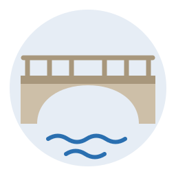
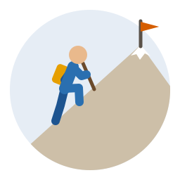
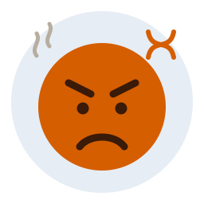
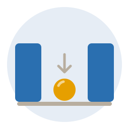
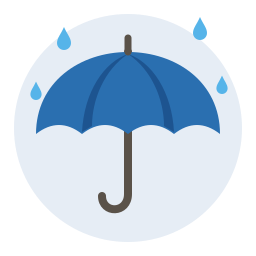

# Picture style (v0.4, style B "düz renk")

> **Superseded on 2026-10-25 by watercolour (`image-v2`).** New pictures are soft watercolour
> washes with pencil outlines (`IMAGE_WC_PALETTE` in `supabase/functions/_shared/image-contract.ts`).
> Each starts with a light wash (`washSand`, `washSky` or `washSage`) under `filter="url(#wash)"`
> instead of the backdrop circle; outlined shapes sit in groups with `filter="url(#line)"`. The
> model never writes `<defs>`: the sanitizer adds the fixed filter block. Contrast and coverage
> are measured against the wash. Flat pictures below stay valid and are shown until their sense
> is redrawn. Decision 0030 (amendment).

The owner picked style **B** from the three samples (A line, B flat, C scene tile) on
22 Oct 2026. This page is the human-readable style guide; the model reads the same rules in the
`image-v1` system prompt (`supabase/functions/_shared/image-prompt.ts`, text in
`docs/ai-image.md`). Decision: `docs/decisions/0029-image-style.md`.

## Rules

- **Flat colour.** Filled shapes from the palette below. No outlines around shapes, no gradients,
  shadows, textures or 3D.
- **Lines are shapes.** A line appears only as a thing of its own (limb, stem, handle, wave), with
  round caps and joins. Typical widths: limbs 12, stems and handles 7–8, details 5–6.
- **Backdrop.** Every picture starts with the soft circle `cx 128, cy 128, r 114`. Everything stays
  inside it; a ground or slope may be cut to its edge with an arc (no `clipPath`).
- **Canvas.** `viewBox="0 0 256 256"`, no width/height. Shown at about 120 px on a card.
- **One subject.** Large, centred, about two thirds of the circle. At most one or two supporting
  cues (raindrops for an umbrella, water under a bridge).
- **No text.** No letters, digits, words, labels, signs with writing or letter-like symbols.
- **People** are simple figures: skin circle head, thick blue limbs, far-side limbs dark blue, no
  facial features unless the meaning is a feeling, no hair styles or clothing details.
- **Kinds of meaning.** Object → the object; action → a figure mid-action; feeling → a big face;
  relation (between, under) → simple blocks/balls and one faint arrow; abstract-but-drawable → the
  most common everyday scene. Abstract or grammar words are **not** drawn (the model declines).
- **Nothing** frightening, violent, sexual, religious or political.

## Palette

Stored SVGs use only the light values; the app swaps each for its dark twin
(`svgForTheme`, `IMAGE_PALETTE` in `_shared/image-contract.ts`). Mapping from the sample
sheet's CSS variables: `--ink`→ink, `--ink-flat`→inkFlat, `--ink-faint`→inkFaint,
`--ink-on-red`→inkOnRed, `--paper`→paper, `--soft`→soft, `--snow` and `--hl`→white (`--hl` is
white with `opacity="0.55"`), `--blue-dark`→blueDark, `--stone-dark`→stoneDark; the others keep
their names.

| Role      | Light     | Dark      | Use                                                        |
| --------- | --------- | --------- | ---------------------------------------------------------- |
| ink       | `#2b2824` | `#ece6dc` | darkest detail: eyes, small marks on light shapes          |
| inkFlat   | `#5a5249` | `#cfc6b8` | handles, poles, tools, wheels                              |
| inkFaint  | `#b8ae9f` | `#6e665b` | arrows, ground lines, steam, motion strokes                |
| inkOnRed  | `#3a1a08` | `#2a1206` | features drawn on red or orange shapes                     |
| paper     | `#fffdf8` | `#3a3631` | off-white parts on top of a coloured shape                 |
| soft      | `#e6edf5` | `#253244` | the backdrop circle only                                   |
| white     | `#ffffff` | `#f2efe9` | snow, highlights (with opacity), teeth; on other shapes    |
| red       | `#d55e00` | `#e4692a` | red things, danger, anger, heat, roofs                     |
| orange    | `#e69f00` | `#ebaa1e` | oranges, fire, warmth, bags, balls, the sun                |
| yellow    | `#f0e442` | `#e8dc5a` | lemons, light, stars; on a darker shape                    |
| green     | `#009e73` | `#1eae84` | leaves, plants, grass                                      |
| sky       | `#56b4e9` | `#68beec` | water drops, ice, sky, glass                               |
| blue      | `#2a6fb0` | `#3f86c8` | people's clothes, water, cold, calm objects                |
| blueDark  | `#1d5490` | `#2c6aa6` | shade side of blue things, far-side limbs                  |
| purple    | `#cc79a7` | `#d88db6` | flowers, fabric, special objects                           |
| stem      | `#6b4a2b` | `#a7774b` | wood, trunks, stems, bread crust                           |
| stone     | `#cdbfa8` | `#8d8170` | stone, sand, walls, light ground                           |
| stoneDark | `#a8977c` | `#6c6253` | shade side of stone, railings, metal                       |
| skin      | `#e9b98c` | `#d7a57a` | hands and heads                                            |

**Contrast.** Against the backdrop, white, paper, yellow and soft are nearly invisible in the
light theme and inkOnRed in the dark theme (ratio < 1.4). They are detail colours: only on top of
another shape. The automatic check (`contrastCheck`) also requires at least one colour with
ratio ≥ 2 in both themes and the backdrop circle itself.

## Parts library

Shared pieces (`supabase/functions/_shared/image-parts.ts`); the model reuses and adapts them so
the pictures look like one family. Each is shown here exactly as the prompt lists it.

### backdrop

```svg
<circle cx="128" cy="128" r="114" fill="#e6edf5"/>
```

### ground

```svg
<rect x="34" y="202" width="188" height="8" rx="4" fill="#b8ae9f"/>
```

### person

```svg
<circle cx="128" cy="62" r="15" fill="#e9b98c"/><path d="M128 140 L116 186 M128 140 L140 186" fill="none" stroke="#1d5490" stroke-width="12" stroke-linecap="round" stroke-linejoin="round"/><path d="M128 86 V140" fill="none" stroke="#2a6fb0" stroke-width="18" stroke-linecap="round"/><path d="M128 94 L104 124 M128 94 L152 124" fill="none" stroke="#2a6fb0" stroke-width="12" stroke-linecap="round" stroke-linejoin="round"/>
```

### face

```svg
<circle cx="128" cy="134" r="80" fill="#e69f00"/><circle cx="104" cy="126" r="7.5" fill="#2b2824"/><circle cx="152" cy="126" r="7.5" fill="#2b2824"/><path d="M100 160 C 112 176, 144 176, 156 160" fill="none" stroke="#2b2824" stroke-width="9" stroke-linecap="round"/>
```

### arrow

```svg
<path d="M128 108 V 142 M116 131 L128 143 L140 131" fill="none" stroke="#b8ae9f" stroke-width="5" stroke-linecap="round" stroke-linejoin="round"/>
```

### motion

```svg
<path d="M52 110 H84 M44 128 H80 M52 146 H84" fill="none" stroke="#b8ae9f" stroke-width="6" stroke-linecap="round"/>
```

### water

```svg
<path d="M70 202 q 14 -9 28 0 t 28 0 t 28 0 t 28 0" fill="none" stroke="#2a6fb0" stroke-width="6" stroke-linecap="round" stroke-linejoin="round"/>
```

### raindrop

```svg
<path d="M64 27 C 67 34, 71 38, 71 43 A 7 7 0 0 1 57 43 C 57 38, 61 34, 64 27 Z" fill="#56b4e9"/>
```

### sun

```svg
<circle cx="128" cy="128" r="40" fill="#e69f00"/><path d="M128 64 V76 M128 180 V192 M64 128 H76 M180 128 H192 M83 83 L91 91 M165 165 L173 173 M83 173 L91 165 M165 91 L173 83" fill="none" stroke="#e69f00" stroke-width="8" stroke-linecap="round"/>
```

### tree

```svg
<rect x="120" y="138" width="16" height="64" rx="4" fill="#6b4a2b"/><circle cx="128" cy="104" r="44" fill="#009e73"/><circle cx="98" cy="128" r="26" fill="#009e73"/><circle cx="158" cy="128" r="26" fill="#009e73"/>
```

### house

```svg
<path d="M72 120 L128 74 L184 120 Z" fill="#d55e00"/><rect x="84" y="118" width="88" height="80" fill="#cdbfa8"/><rect x="116" y="150" width="24" height="48" rx="3" fill="#6b4a2b"/>
```

### highlight

```svg
<path d="M84 112 C 86 98, 96 90, 106 88" fill="none" stroke="#ffffff" stroke-width="8" stroke-linecap="round" opacity="0.55"/>
```

### emphasis

```svg
<g fill="none" stroke="#d55e00" stroke-width="6" stroke-linecap="round"><path d="M186 40 C 188 50, 192 54, 202 56"/><path d="M218 40 C 216 50, 212 54, 202 56"/><path d="M186 72 C 188 62, 192 58, 202 56"/><path d="M218 72 C 216 62, 212 58, 202 56"/></g>
```

### no

```svg
<circle cx="128" cy="128" r="72" fill="none" stroke="#d55e00" stroke-width="14"/><path d="M77 77 L179 179" fill="none" stroke="#d55e00" stroke-width="14" stroke-linecap="round"/>
```

## Approved references

The six samples the owner approved, in stored format (`docs/image-style/refs/`, the same
strings as `_shared/image-refs.ts`; the prompt shows them as examples):

| apple (elma) | bridge (köprü) | climb (tırmanmak) |
| --- | --- | --- |
|  |  |  |
| **angry (kızgın)** | **between (arasında)** | **umbrella (şemsiye)** |
|  |  |  |

`climb` clipped its mountain to the backdrop with `<clipPath>` in the sample; the stored copy draws
the clipped outline as one path with an arc, because `clipPath` and `url()` are not allowed.

## Do / don't

| Do | Don't |
| --- | --- |
| One big subject on the backdrop | Several small objects spread around |
| Explicit `fill` on every shape | Rely on the default fill (black, no dark twin) |
| Light colours on top of another shape | White, yellow or paper straight on the backdrop |
| Faint arrow for a relation or direction | Arrows as the main subject |
| Decline abstract and grammar words | Force a symbol (a heart for "love it", a bulb for "idea") when it misleads |
| Whole numbers or one decimal | Long decimals, ids, comments, `<title>` |
| ≤ 3 KB typical, 8 KB hard limit | Gradients, filters, `clipPath`, `<text>`, `<use>`, `style` |
